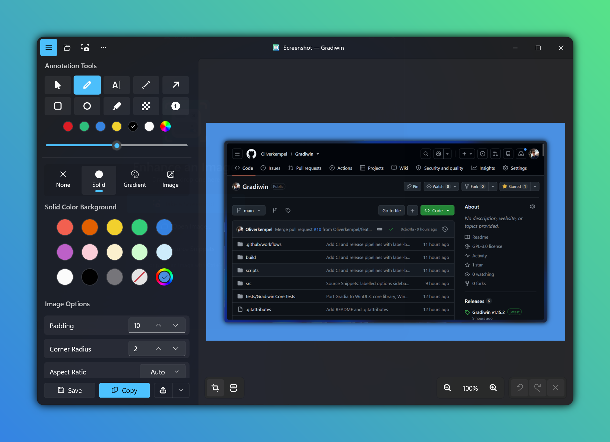
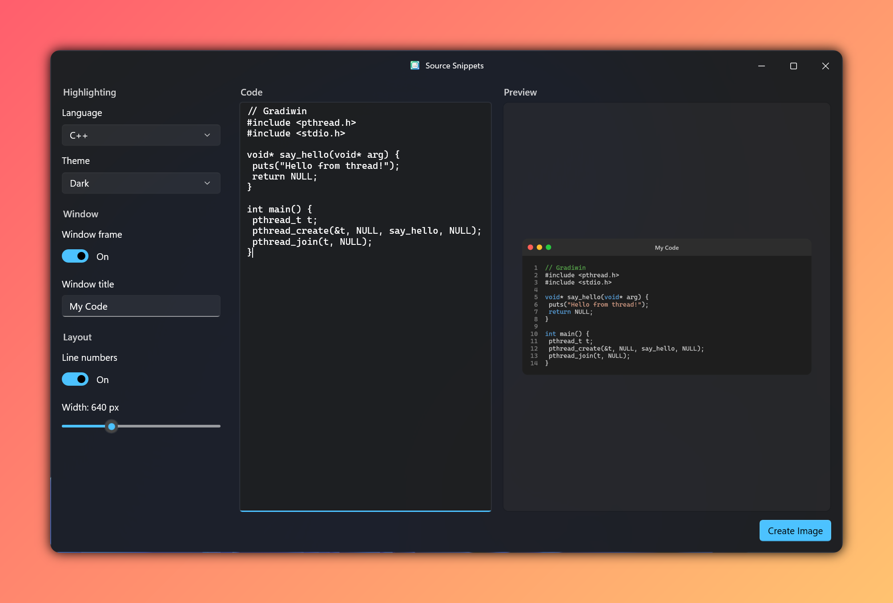

# Gradiwin

A native Windows port of [Gradia](https://github.com/AlexanderVanhee/Gradia) by Alexander Vanhee: *make your screenshots ready for the world*.
Built with WinUI 3 (Windows App SDK 1.8), C#/.NET 10 and Win2D, packaged as MSIX.

Editing                                            |  Source snippits
:-------------------------------------------------:|:-----------------------------------------------------:
  |  


## Why this port exists

I really liked using Gradia on Linux. It made turning a quick screenshot into something presentable effortless. For work, though, I use Windows, and I kept missing it.

So I used an LLM to port Gradia to Windows. The goal was an app that feels at home on Windows rather than a wrapped Linux app, with full feature parity with the original. It uses native Windows building blocks: WinUI 3, Fluent design, Windows OCR, the Share sheet, and the Print Screen key. The few places where it works differently are listed under [Differences from Gradia](#differences-from-gradia).

All credit for the idea, the design and the original implementation goes to **Alexander Vanhee** and the Gradia contributors. This port builds directly on their work, including its algorithms, presets, icons, background images and translations. Thank you for making such a lovely tool and sharing it under the GPL. If you use Linux, please use [the original](https://github.com/AlexanderVanhee/Gradia), and consider [supporting its author](https://ko-fi.com/alexandervanhee).

## Features

- **Image sources:** open file, drag and drop (files, web URLs, bitmaps), paste (file lists and raw bitmaps), stdin, the Share sheet, the recent-screenshots picker and source-code snippets.
- **Screenshots:** interactive region or window picker, or all screens (`--screenshot[=INTERACTIVE|FULL] --delay=ms`).
- **Backgrounds:** none, solid (14 presets plus custom), gradient (linear, radial or conic, with a stop editor, angle dial and 6 presets) or image (9 presets plus custom).
- **Image options:** padding, corner radius, shadow, aspect ratio (presets or custom), auto balance and rotation.
- **Annotations:** select/move/resize, pen, text (fill and outline), line, arrow, rectangle, oval, highlighter, censor (pixelate) and auto-renumbering number stamps.
  - Undo and redo also cover moves, resizes and text edits.
- **Crop:** with aspect locks.
- **Zoom and pan:** Ctrl+wheel or pinch to zoom; middle-drag or Space-drag to pan.
- **Export:** save as PNG, JPEG or WebP, copy, the Windows Share sheet, and upload (GoFile, Imgur, or a custom PowerShell command).
- **OCR:** text extraction with the built-in Windows OCR engine.
- **Print Screen:** PrtScn opens Gradiwin's picker instead of Snipping Tool, and Ctrl+PrtScn captures all screens. While this is on, Gradiwin stays in the notification area.
- **Other:** pin windows (`--pin`), preferences, Gradia's keyboard shortcuts, and Gradia's 22 translations (its `.po` files are used as-is).

## Installation

Download a release from the [Releases page](../../releases). Each release has two kinds of download, each for **x64** (most PCs) and **ARM64** (Snapdragon and other Arm PCs):

| File | What it is |
|---|---|
| `Gradiwin-<version>-<arch>.msix` | Installable package (recommended) |
| `Gradiwin-<version>-<arch>-portable.zip` | Standalone app; unzip and run, nothing is installed |
| `Gradiwin.cer` | Certificate needed once to install the MSIX |

You need Windows 10 version 2004 (build 19041) or later, or Windows 11.

### MSIX package (recommended)

The package is signed with Gradiwin's own self-signed certificate rather than one from a certificate authority. So the first time, Windows has to be told to trust it:

1. Download `Gradiwin.cer` and the `.msix` for your PC.
2. Trust the certificate. You only do this once; later releases use the same certificate.
   - Double-click `Gradiwin.cer` and choose **Install Certificate…**.
   - Pick **Local Machine** (this needs admin rights).
   - Choose **Place all certificates in the following store**, then **Browse… › Trusted People**.
   - Click **Finish**.

   Or, in an administrator PowerShell:
   ```powershell
   Import-Certificate -FilePath .\Gradiwin.cer -CertStoreLocation Cert:\LocalMachine\TrustedPeople
   ```
3. Double-click the `.msix` and click **Install**. Or, in PowerShell:
   ```powershell
   Add-AppxPackage .\Gradiwin-<version>-x64.msix
   ```

The package needs the Windows App SDK 1.8 runtime. Windows normally installs it automatically. If installation complains about a missing framework, install the runtime from [Microsoft's Windows App SDK downloads](https://learn.microsoft.com/windows/apps/windows-app-sdk/downloads) and try again.

- **Updating:** install a newer `.msix` the same way. It replaces the old version and keeps your settings.
- **Uninstalling:** *Settings › Apps › Installed apps › Gradiwin › Uninstall*.

### Portable zip

1. Download the `-portable.zip` for your PC.
2. Before extracting, right-click the zip and choose **Properties**. Tick **Unblock** if it's there, then click **OK**.
3. Extract it anywhere, for example `C:\Tools\Gradiwin`, and run `Gradiwin.exe`. The executable isn't signed. If SmartScreen warns you, choose **More info › Run anyway**.

The zip contains everything it needs, including .NET and the Windows App SDK, so nothing else has to be installed. Settings are stored in `%LOCALAPPDATA%\Gradiwin`.

- **Updating:** replace the folder's contents with the newer release.
- **Uninstalling:** delete the folder, and `%LOCALAPPDATA%\Gradiwin` if you want your settings gone too.

### MSIX vs portable

The editor is the same in both. Some Windows integrations need an installed package, so the zip doesn't have them:

| | MSIX | Portable zip |
|---|:---:|:---:|
| Editing, export, upload, OCR and code snippets | ✓ | ✓ |
| Print Screen opens Gradiwin, with the notification-area icon | ✓ | ✓, while Gradiwin is running |
| **Start with Windows**, so Print Screen works right after you sign in | ✓ | – |
| `gradia` / `gradiwin` commands in any terminal (`gradia --screenshot`) | ✓ | – (run `Gradiwin.exe` with the same options instead) |
| **Open with › Gradiwin** for PNG, JPEG, WebP, AVIF and BMP files | ✓ | – |
| **Edit in Gradiwin** target in the Windows Share sheet | ✓ | – |
| Start menu entry, and clean uninstall from Settings | ✓ | – |
| Runs without installing anything or importing a certificate | – | ✓ |
| Download size | about 20 MB | about 120 MB (everything bundled) |

## Differences from Gradia

| Gradia (Linux) | Gradiwin |
|---|---|
| Pillow, Cairo, Pango and a C gradient library | Win2D. The gradient algorithm is ported exactly and unit-tested against reference pixels. |
| xdg screenshot portal | GDI capture plus a custom region/window overlay. Screenshots are saved to `Pictures\Screenshots`, or the folder set in Preferences. |
| tesseract and downloaded models | Windows.Media.Ocr, which uses installed Windows language packs |
| bash upload commands | Native HttpClient uploaders. The custom command runs in PowerShell, and `$1` is replaced with the image path. Imgur needs your own client ID. |
| GtkSourceView snippets | ColorCode tokenizer with Win2D rendering. Only Dark and Light themes are available. |
| Ctrl+O is bound to both Open and OCR | Ctrl+O opens a file; Ctrl+Shift+O runs OCR |

## Building

You need the .NET 10 SDK, the Windows App SDK 1.8 runtime and Windows 10 19041 or later.

```bash
dotnet test tests/Gradiwin.Core.Tests
dotnet build src/Gradiwin/Gradiwin.csproj -p:Platform=x64
```

There are three ways to run the app:

- **Packaged without Visual Studio's WinUI workload:** turn on Developer Mode, then run `pwsh scripts/deploy-dev.ps1 -Launch` to build, register and start the app.
- **Packaged:** turn on Developer Mode, then press F5 in Visual Studio, or run `Add-AppxPackage -Register src\Gradiwin\bin\x64\Debug\net10.0-windows10.0.22621.0\AppxManifest.xml`. The package adds the `gradia` / `gradiwin` command aliases.
- **Unpackaged:** build with `-p:WindowsPackageType=None -p:WindowsAppSDKSelfContained=true -p:RuntimeIdentifier=win-x64 -p:SelfContained=true`. Packaged-only features don't work this way: share target, notifications and command aliases.

To create an MSIX: `dotnet build src/Gradiwin/Gradiwin.csproj -c Release -p:Platform=x64 -p:GenerateAppxPackageOnBuild=true`. Sign it with your own certificate before installing.

Debug builds include `Gradiwin.exe --selftest <image> <outdir>`, which renders every background, annotation type, export format, crop, snippet and OCR without any UI input.

## CI and releases

`main` is protected: changes go in through pull requests.

- **CI** (`.github/workflows/ci.yml`) runs on every PR into `main`:
  - It works out the version that merging would release and shows it in the run summary.
  - It runs the unit tests and builds the x64 portable zip and MSIX.
  - Its **Build & test** check must pass before merging.
- **Release** (`.github/workflows/release.yml`) runs when a PR is merged:
  - It bumps the latest `vX.Y.Z` tag according to the merged PR's label: `major`, `minor` or `patch` (the default when no label is set).
  - It builds x64 and ARM64 portable zips and signed MSIX packages, then creates the tag and a GitHub Release with generated notes.
  - Add the `skip-release` label to merge without releasing.
  - You can also start it manually from the Actions tab.
- **First release:** while there are no tags, the first release uses the version in `Directory.Build.props`.
- **Signing:** MSIX packages are signed with a self-signed certificate, `CN=Gradiwin`, which must match the manifest's Publisher.
  - The secrets `MSIX_CERT_PFX` (base64 PFX) and `MSIX_CERT_PASSWORD` hold the key. The public certificate is `build/Gradiwin.cer`.
  - To install a release MSIX, import that certificate into *Local Machine › Trusted People*.

## Repository layout

- `src/Gradiwin.Core`: platform-independent logic. This covers the models, the gradient generator, the layout maths, the auto-balance analyzer, annotations with undo, the crop model, the CLI parser and the `.po` reader.
- `src/Gradiwin`: the WinUI 3 app. `Rendering/` holds the Win2D pipeline, `Controls/`, `Views/`, `Services/`.
- `tests/Gradiwin.Core.Tests`: xUnit tests.
- `scripts/svg2icons.py` converts Gradia's symbolic SVG icons into theme-aware path icons. `scripts/IconRenderer` renders the MSIX logos.

## License

GPL-3.0-or-later, the same as Gradia. Assets, translations and presets come from Gradia.
